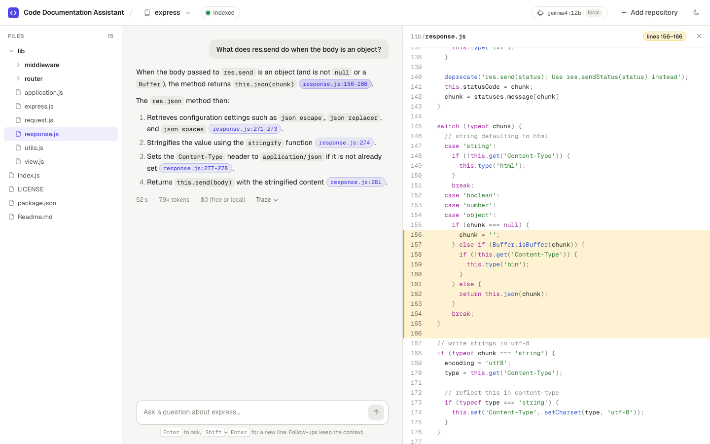
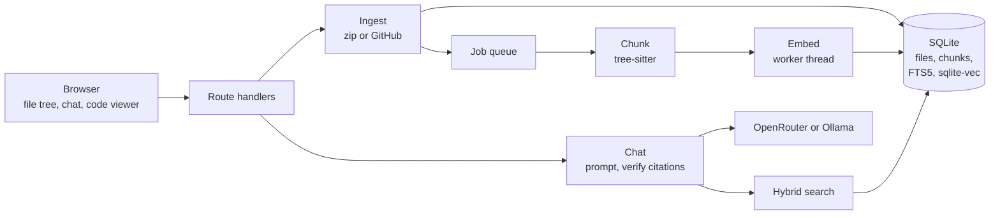
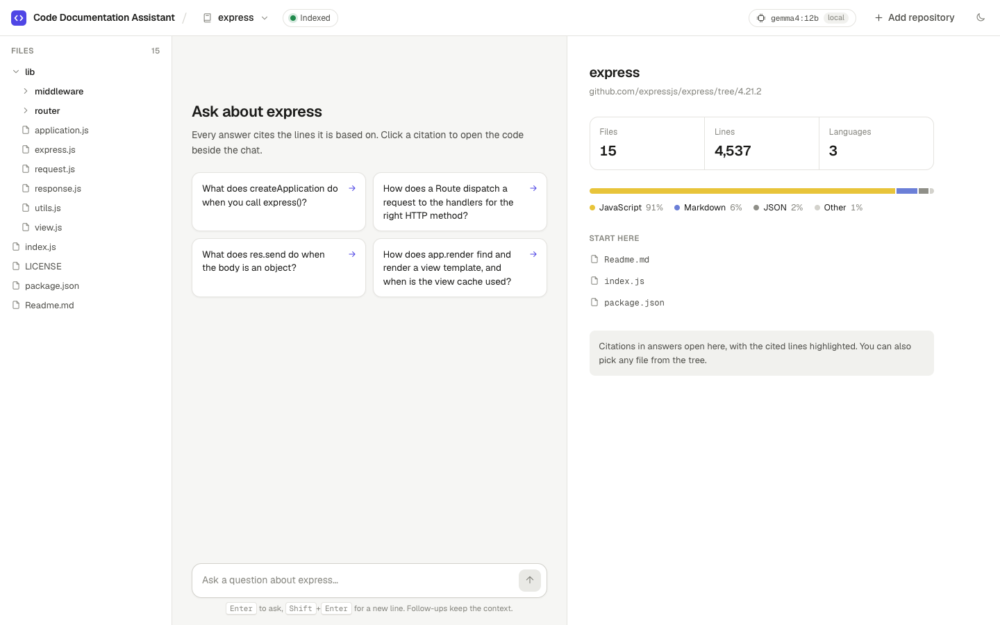
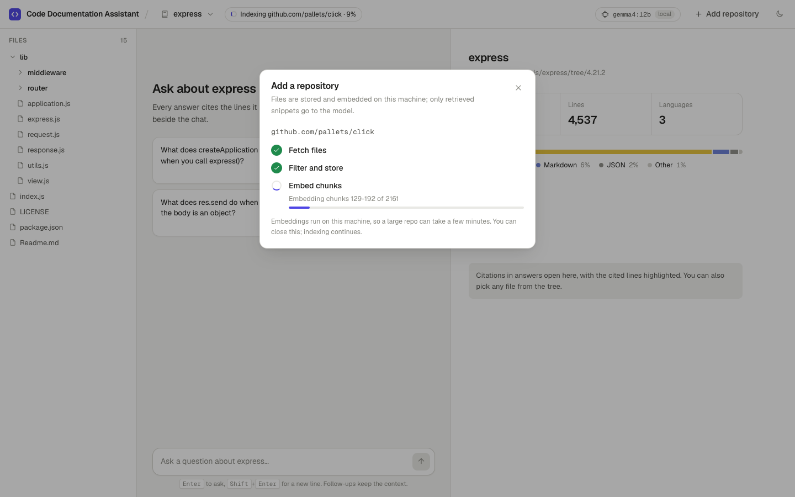
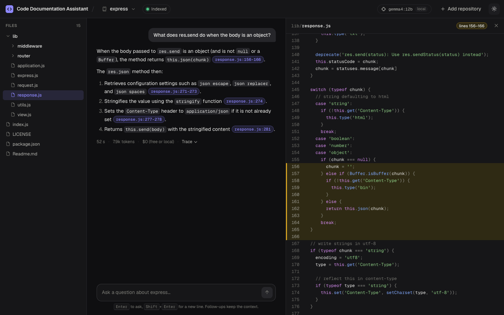

# Code Documentation Assistant

Ask questions about a codebase and get answers that cite `file:line`. Click a citation and the code opens beside the chat with those lines highlighted.



A 47 second walkthrough with captions is in [`docs/demo.mp4`](docs/demo.mp4).

## Run it

Node 22 and pnpm. No database server, no Docker, no embeddings key.

```bash
git clone https://github.com/itsSilver/code-documentation-assistant.git
cd code-documentation-assistant
cp .env.example .env      # set OPENROUTER_API_KEY, or LLM_PROVIDER=ollama with LLM_MODEL
pnpm install
pnpm dev                  # http://localhost:3000
```

The first start downloads a 35 MB embedding model and indexes a bundled sample repo, Express 4.21.2, in the background. Without a model key the app still indexes and browses code, and the chat tells you what to set. Free OpenRouter models may log prompts, so do not index private code with one.

`pnpm test`, `pnpm lint`, `pnpm typecheck` and `pnpm eval` do what their names say.

## Architecture

One Next.js process and one SQLite file.



**Indexing.** A zip upload or a public GitHub URL is filtered, then stored as whole files. The repo is browsable at that point. A background queue chunks and embeds it, and each batch is searchable as soon as it is stored.

**Answering.** A follow up is rewritten into a standalone question. Hybrid search returns the top 12 chunks, which are packed into a 6,000 token budget. The model answers from those chunks only and cites line ranges. The server drops every citation that does not match a chunk the model was shown.

```
src/
  app/            routing only, thin route handlers
  features/       browser code per feature, workspace, chat, ingest, repo
  components/ui/  primitives with no knowledge of features
  server/         Node code per capability, ingest, chunk, embed, search, chat, llm, obs, db
  shared/         API contracts used by both sides
```

## Key decisions

- **It runs in five minutes.** One process, one data file, one key at most. This constraint decided most of what follows.
- **Chunk by symbol.** People ask about code by name, so `tree-sitter` splits TypeScript, JavaScript, Python, Go and Java into functions, classes and types. Large symbols and other files fall back to line windows with overlap.
- **Local embeddings.** A small model, `bge-small-en-v1.5`, runs on the CPU. No second key, and the repo is never sent to a third party for indexing. It is weaker on code than a large hosted model, and keyword search covers that gap.
- **SQLite for everything.** `sqlite-vec` for vectors and FTS5 for keywords, in the same file as the source. Postgres with pgvector or a vector database would add a service for a few thousand chunks per repo.
- **Hybrid search with rank fusion.** Vector search misses exact names and keyword search misses paraphrases. Reciprocal rank fusion merges both by rank, with a small boost when the question names a symbol or file. No reranker yet.
- **No framework, two providers.** The pipeline is five plain functions, so the prompt and the citation handling stay visible. Any OpenAI compatible endpoint works, and I support OpenRouter with a free default model and local Ollama.
- **Citations are verified, not trusted.** The prompt marks retrieved code as untrusted data, numbers every line, and fixes the sentence for when the answer is not in the repo. The server then checks each citation, so a clickable one always points at real retrieved code.
- **Embedding off the request path.** A queue and a worker thread, so a large repo never blocks the server and you can ask questions while it embeds.
- **A trace per answer.** Time per step, time to first token, tokens, cost and chunk ids, shown under the answer and logged as one JSON line. Logs never contain secrets or file contents.
- **Feature modules with enforced boundaries.** Full DDD layers would be mostly empty here. Lint rules stop browser code from importing server code and features from importing each other.

## Quality

`pnpm eval` runs 28 fixed questions against the sample repo, 23 answerable and 5 that the repo cannot answer. The right code is in the top 10 for 96 percent of the answerable ones and first for 39 percent, with an MRR of 0.579. Recall is fine and ranking is the weak part, so a reranker is the next step. Results are in `evals/results/`.

## Production

Today it is a single machine design. State is one SQLite file, the job queue is in memory, embeddings share the CPU of the web server, and there is no auth or rate limiting.

To scale it I would do this, in order.

1. A container, then Postgres with pgvector, and object storage for source files. Only the repository class talks SQL.
2. A managed queue with separate workers for indexing, such as SQS or Cloud Tasks, and indexing only changed files.
3. Embeddings behind their own service or a hosted API, so web instances stay stateless.
4. Sign in, tenant isolation, and a GitHub App for private repos.
5. Rate limits per user and a spend cap on the model key.
6. OpenTelemetry traces, error tracking, and the eval in CI.

That maps to Cloud Run, ECS Fargate or Azure Container Apps with managed Postgres and a queue. Cloudflare Workers cannot run it as is because SQLite and the embedding model are native modules. Cloudflare Containers can, or Workers after moving to D1, Vectorize, Workers AI and Queues.

## Engineering standards

**Followed.** 176 tests next to the code, with the model and embedder injected so they run offline. CI runs lint, typecheck and tests. Strict TypeScript, ESLint and Prettier. Module boundaries as lint rules. Migrations that only append. Secrets out of git and out of logs. A repeatable eval with committed results.

**Skipped on purpose.** A container image, since SQLite and pnpm keep setup small and it is the first thing I would add. Browser tests against a real server. Auth and rate limiting, since this is a local tool for one user. Error tracking. Evals in CI, since they need a model.

## How I used AI tools

Coding agents, mainly Claude Code, did most of the typing. I kept the decisions.

I fixed the product and the stack first and wrote them into a short rules file the agents read on every run, including the decisions that were not open for debate. Work went in small tasks, each with its own diff that I reviewed. Tests, lint and typecheck had to pass before I looked at anything, and retrieval changes were judged by the eval, not by impression.

What works is tight constraints, a clear definition of done, small tasks, and proof through tests or numbers. What I avoid is letting the agent choose the architecture, add dependencies nobody asked for, or claim something works without showing it.

## With more time

- A reranker over the top 30 candidates.
- A Dockerfile and a hosted demo with a spend cap.
- A persistent job queue and indexing only changed files.
- Private repos and branch selection.
- More languages and an embedding model trained on code.
- Browser tests with Playwright, and the eval in CI with a strong judge model.

## Known limits

- Public GitHub repos only.
- Languages without a grammar are chunked by line windows.
- Files over 256 KB, binaries, lockfiles and build folders are skipped.
- An embedding interrupted by a restart does not resume. The repo is flagged and can be indexed again.

## Screenshots

| Home                               | Indexing a repository                   |
| ---------------------------------- | --------------------------------------- |
|  |  |

| An answer with citations               | Dark theme                         |
| -------------------------------------- | ---------------------------------- |
|  |  |
